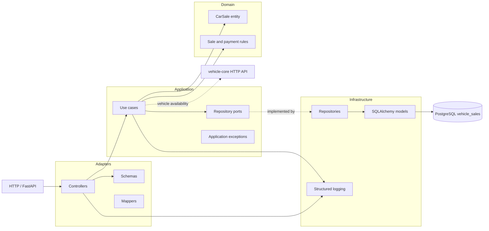
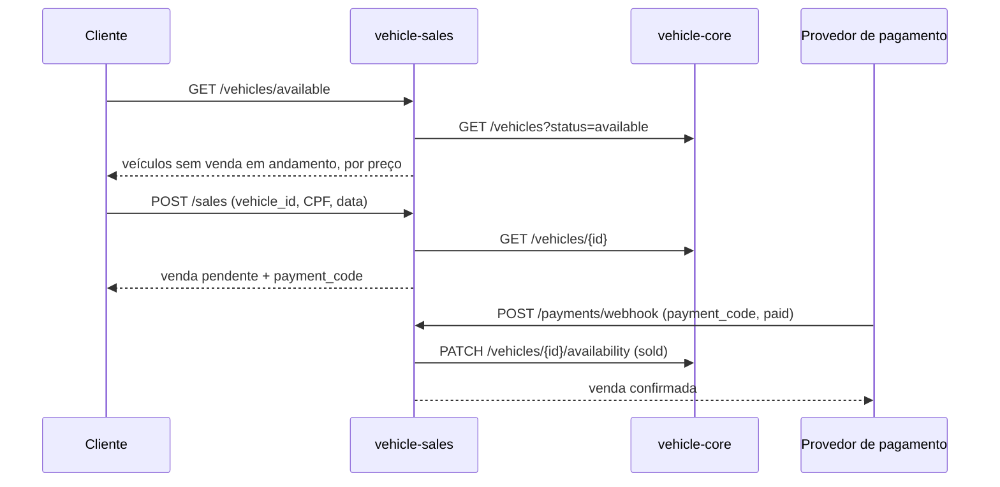
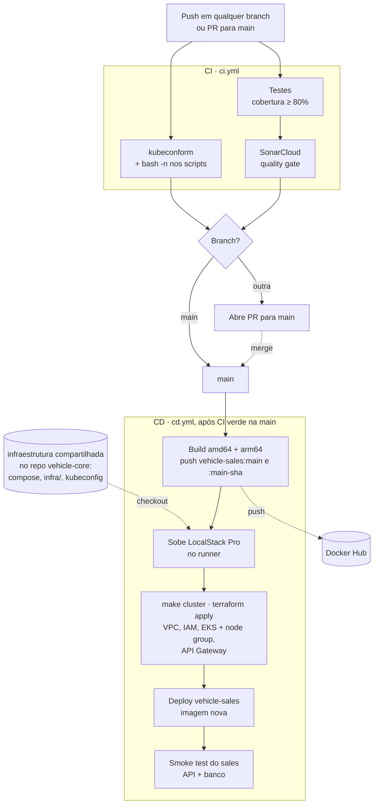

[](https://sonarcloud.io/summary/new_code?id=nessaoana_vehicle-sales)  [](https://sonarcloud.io/summary/new_code?id=nessaoana_vehicle-sales)
# vehicle-sales

Serviço de venda de veículos, com API Python, PostgreSQL e LocalStack.

## Arquitetura em camadas



A comunicação com o `vehicle-core` acontece por HTTP. O serviço de vendas tem
banco próprio e não acessa as tabelas do serviço principal: os dados dos
veículos são lidos do `vehicle-core` a cada listagem, e o banco `vehicle_sales`
guarda apenas as vendas.

## Fluxo de venda



| Método | Rota | Descrição |
|---|---|---|
| `GET` | `/vehicles/available` | Veículos à venda, do mais barato para o mais caro |
| `GET` | `/vehicles/sold` | Veículos vendidos, do mais barato para o mais caro |
| `POST` | `/sales` | Compra: reserva o veículo e gera o código de pagamento |
| `POST` | `/payments/webhook` | Confirma (`paid`) ou cancela (`cancelled`) o pagamento |
| `GET` | `/health`, `/health/ready` | Processo disponível / processo e banco disponíveis |

As listagens aceitam os filtros opcionais `brand`, `model`, `min_year` e
`max_year`. Um veículo com venda pendente sai da listagem de disponíveis e não
pode ser comprado de novo; se o pagamento for cancelado, ele volta a ficar
disponível. A documentação interativa fica em `/docs`.

## Desenvolvimento local

O serviço depende do `vehicle-core` rodando. Com o core na porta `8081`, crie
o `.env` a partir de `.env.example` e execute:

```bash
python3 -m venv .venv
.venv/bin/pip install -r app/src/requirements.txt
PYTHONPATH=app .venv/bin/pytest app/tests --cov=app/src --cov-report=term-missing --cov-fail-under=80
PYTHONPATH=app .venv/bin/python -m uvicorn src.main:app --host 127.0.0.1 --port 8082 --reload
```

Com Docker, `docker compose up --build` sobe a API na porta `8000` com o
PostgreSQL `vehicle_sales`. Dentro do container, o core é acessado em
`http://host.docker.internal:8001`, a porta do container do `vehicle-core`.

## Testando o fluxo

Com os dois serviços rodando localmente:

```bash
# 1. Cadastra um veículo no vehicle-core
curl -X POST http://127.0.0.1:8081/vehicles \
	-H 'Content-Type: application/json' \
	-d '{"license_plate": "ABC1D23", "brand": "Toyota", "model": "Corolla", "year": 2024, "price": "75000.00"}'

# 2. Lista os veículos à venda
curl 'http://127.0.0.1:8082/vehicles/available?brand=toyota'

# 3. Compra o veículo; a resposta traz o payment_code
curl -X POST http://127.0.0.1:8082/sales \
	-H 'Content-Type: application/json' \
	-d '{"vehicle_id": 1, "buyer_cpf": "529.982.247-25", "sale_date": "2026-10-10"}'

# 4. Simula o provedor de pagamento confirmando a compra
curl -X POST http://127.0.0.1:8082/payments/webhook \
	-H 'Content-Type: application/json' \
	-d '{"payment_code": "<payment_code>", "status": "paid"}'

# 5. O veículo aparece entre os vendidos
curl http://127.0.0.1:8082/vehicles/sold
```

## Infraestrutura

No ambiente publicado (LocalStack Pro), o vehicle-sales roda no cluster EKS
`vehicle-cluster`, que é criado pelo repositório
[vehicle-core](https://github.com/nessaoana/vehicle-core#infraestrutura) junto
com o API Gateway. Este repositório só contém o que é do serviço de vendas:

| Caminho | Conteúdo |
|---|---|
| [`k8s/`](k8s/) | Namespace `vehicle-sales`, Postgres próprio (StatefulSet), Deployment, Service, HPA e Ingress |
| [`scripts/deploy.sh`](scripts/deploy.sh) | Cria o Secret do banco, aplica os manifestos e espera o rollout |

- **Banco isolado**: o Postgres `vehicle_sales` roda no namespace do serviço e
  só guarda as vendas.
- **Comunicação com o core**: HTTP pelo DNS do cluster
  (`VEHICLE_CORE_URL=http://vehicle-core-api.vehicle-core.svc.cluster.local:8000`,
  no [ConfigMap](k8s/api-configmap.yaml)).
- **Autoscaling**: o HPA mantém de 2 a 6 réplicas (CPU 60% ou memória 75%),
  para absorver picos de listagem e compra.
- **Exposição pública**: `GET /vehicles/available`, `GET /vehicles/sold`,
  `POST /sales` e `POST /payments/webhook` passam pelo API Gateway e pelo load
  balancer (Traefik). O Ingress deste serviço tem prioridade sobre o prefixo
  `/vehicles` do core.

Com o cluster criado pelo vehicle-core (`make localstack cluster` lá):

```bash
make deploy                 # imagem nessaoana/vehicle-sales:main
make deploy IMAGE_TAG=main-abc1234
make smoke-test             # API no ar e conectada ao banco vehicle_sales
make load-test GATEWAY_URL=$(make -sC ../vehicle-core gateway-url)  # HPA (requer hey)
```

O fluxo completo de compra, com os dois serviços publicados, é testado no
vehicle-core com `make e2e-test`.

## CI/CD



A infraestrutura é compartilhada e centralizada no
[vehicle-core](https://github.com/nessaoana/vehicle-core#onde-o-terraform-é-usado):
o CD faz checkout de lá só para subir o LocalStack e rodar o `make cluster`,
que aplica o [`infra/`](https://github.com/nessaoana/vehicle-core/tree/main/infra)
no runner. O vehicle-core em si não é publicado nem testado neste pipeline.

O CI roda em pushes para qualquer branch e em PRs para `main`:

- build e testes, com cobertura mínima de 80%;
- análise no SonarCloud, que bloqueia a alteração se o quality gate falhar;
- validação dos manifestos Kubernetes com `kubeconform`.

Se o CI passar:

- **em outra branch**, um PR para `main` é aberto automaticamente;
- **na `main`**, o CD publica a imagem `vehicle-sales:main-<sha>`, cria o
  cluster e o API Gateway com a infraestrutura do vehicle-core, publica o
  vehicle-sales e roda o smoke test do serviço (API no ar e conectada ao banco
  `vehicle_sales`).

O CD precisa destes secrets e variables:
`LOCALSTACK_AUTH_TOKEN`, `DOCKERHUB_TOKEN`, `SALES_POSTGRES_PASSWORD`,
`DOCKERHUB_USERNAME` e, opcionalmente, `LOCALSTACK_POD`.
